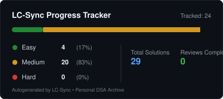

# ⚡ LeetCode Daily

> My LeetCode problem-solving journey — automatically synchronized to GitHub using LC-Sync.

<!-- lc-sync:start -->
## 🔗 LeetCode Profile

[prishabh3](https://leetcode.com/u/prishabh3/)

## LeetCode Stats

[](https://leetcode.com/u/prishabh3/)

## Submission Activity

[](https://leetcode.com/u/prishabh3/)

## 📊 Repository Progress

<p align="center">
  
</p>

[]() [](https://leetcode.com/u/prishabh3/) [](https://github.com/prishabh3)

- **Distinct Problems Tracked**: **32**
- **Total Accepted Submissions**: **37**
- **Repository Solutions & Historical Versions**: **37** • [GitHub Solutions Repo](https://github.com/prishabh3/leetcode-daily)

### 🎯 Difficulty Breakdown
| Difficulty | Solved |
| :--- | :--- |
| 🟢 Easy | **4** |
| 🟡 Medium | **28** |
| 🔴 Hard | **0** |

### 💻 Language Distribution
| Language | Solved Problems |
| :--- | :--- |
| C++ | `26` |
| SQL | `3` |
| Python 3 | `3` |

### 🏷️ Topic Tags
_No topic tags recorded yet._

---

## 📚 Solution Directory

👉 **[Browse All Solutions → problems/](./problems/)**

### Recently Synchronized Problems

| Problem | Difficulty | Language | Solution |
| :--- | :-: | :--- | :--- |
| [0228. Summary Ranges](./problems/0228-summary-ranges) | Medium | C++ | [solution.cpp](./problems/0228-summary-ranges/cpp/solution.cpp) |
| [4078. Maximum Alternating Sum of Squares](./problems/4078-maximum-alternating-sum-of-squares) | Medium | C++ | [solution.cpp](./problems/4078-maximum-alternating-sum-of-squares/cpp/solution.cpp) |
| [3153. Apply Operations on Array to Maximize Sum of Squares](./problems/3153-apply-operations-on-array-to-maximize-sum-of-squares) | Medium | C++ | [solution.cpp](./problems/3153-apply-operations-on-array-to-maximize-sum-of-squares/cpp/solution.cpp) |
| [2844. Sum of Squares of Special Elements ](./problems/2844-sum-of-squares-of-special-elements) | Medium | C++ | [solution.cpp](./problems/2844-sum-of-squares-of-special-elements/cpp/solution.cpp) |
| [2418. Minimum Sum of Squared Difference](./problems/2418-minimum-sum-of-squared-difference) | Medium | C++ | [solution.cpp](./problems/2418-minimum-sum-of-squared-difference/cpp/solution.cpp) |
| [1791. Richest Customer Wealth](./problems/1791-richest-customer-wealth) | Medium | C++ | [solution.cpp](./problems/1791-richest-customer-wealth/cpp/solution.cpp) |
| [1648. Minimum Insertions to Balance a Parentheses String](./problems/1648-minimum-insertions-to-balance-a-parentheses-string) | Medium | C++ | [solution.cpp](./problems/1648-minimum-insertions-to-balance-a-parentheses-string/cpp/solution.cpp) |
| [1078. Remove Outermost Parentheses](./problems/1078-remove-outermost-parentheses) | Medium | C++ | [solution.cpp](./problems/1078-remove-outermost-parentheses/cpp/solution.cpp) |

<details>
<summary><strong>View All Tracked Problems (32)</strong></summary>

| # | Title | Difficulty | Languages | Topics | Notes | Date Solved | Next Revision |
| :-: | :--- | :-: | :--- | :--- | :-: | :-: | :-: |
| 0001 | [Two Sum](./problems/0001-two-sum) | Medium | [`C++`](./problems/0001-two-sum/cpp) | - | [Notes](./problems/0001-two-sum/notes.md) | 2026-10-25 | `2026-10-25` |
| 0002 | [Add Two Numbers](./problems/0002-add-two-numbers) | Medium | [`C++`](./problems/0002-add-two-numbers/cpp) | - | [Notes](./problems/0002-add-two-numbers/notes.md) | 2026-10-25 | `2026-10-25` |
| 0004 | [Median of Two Sorted Arrays](./problems/0004-median-of-two-sorted-arrays) | Medium | [`C++`](./problems/0004-median-of-two-sorted-arrays/cpp) | - | [Notes](./problems/0004-median-of-two-sorted-arrays/notes.md) | 2026-10-25 | `2026-10-25` |
| 0013 | [Roman to Integer](./problems/0013-roman-to-integer) | Easy | [`C++`](./problems/0013-roman-to-integer/cpp) | - | [Notes](./problems/0013-roman-to-integer/notes.md) | 2026-10-25 | `2026-10-27` |
| 0015 | [3Sum](./problems/0015-3sum) | Medium | [`C++`](./problems/0015-3sum/cpp) | - | [Notes](./problems/0015-3sum/notes.md) | 2026-10-25 | `2026-10-25` |
| 0020 | [Valid Parentheses](./problems/0020-valid-parentheses) | Medium | [`C++`](./problems/0020-valid-parentheses/cpp) | - | [Notes](./problems/0020-valid-parentheses/notes.md) | 2026-10-25 | `2026-10-25` |
| 0022 | [Generate Parentheses](./problems/0022-generate-parentheses) | Medium | [`C++`](./problems/0022-generate-parentheses/cpp) | - | [Notes](./problems/0022-generate-parentheses/notes.md) | 2026-10-25 | `2026-10-25` |
| 0032 | [Longest Valid Parentheses](./problems/0032-longest-valid-parentheses) | Medium | [`C++`](./problems/0032-longest-valid-parentheses/cpp) | - | [Notes](./problems/0032-longest-valid-parentheses/notes.md) | 2026-10-25 | `2026-10-25` |
| 0089 | [Gray Code](./problems/0089-gray-code) | Medium | [`C++`](./problems/0089-gray-code/cpp) | - | [Notes](./problems/0089-gray-code/notes.md) | 2026-10-25 | `2026-10-25` |
| 0094 | [Binary Tree Inorder Traversal](./problems/0094-binary-tree-inorder-traversal) | Medium | [`C++`](./problems/0094-binary-tree-inorder-traversal/cpp) | - | [Notes](./problems/0094-binary-tree-inorder-traversal/notes.md) | 2026-10-25 | `2026-10-25` |
| 0178 | [Rank Scores](./problems/0178-rank-scores) | Medium | [`SQL`](./problems/0178-rank-scores/sql) | - | [Notes](./problems/0178-rank-scores/notes.md) | 2026-10-25 | `2026-10-27` |
| 0197 | [Rising Temperature](./problems/0197-rising-temperature) | Easy | [`SQL`](./problems/0197-rising-temperature/sql) | - | [Notes](./problems/0197-rising-temperature/notes.md) | 2026-10-25 | `2026-10-27` |
| 0228 | [Summary Ranges](./problems/0228-summary-ranges) | Medium | [`C++`](./problems/0228-summary-ranges/cpp) | - | [Notes](./problems/0228-summary-ranges/notes.md) | 2026-10-25 | `2026-10-25` |
| 0301 | [Remove Invalid Parentheses](./problems/0301-remove-invalid-parentheses) | Medium | [`C++`](./problems/0301-remove-invalid-parentheses/cpp) | - | [Notes](./problems/0301-remove-invalid-parentheses/notes.md) | 2026-10-25 | `2026-10-25` |
| 0595 | [Big Countries](./problems/0595-big-countries) | Easy | [`SQL`](./problems/0595-big-countries/sql) | - | [Notes](./problems/0595-big-countries/notes.md) | 2026-10-25 | `2026-10-27` |
| 0678 | [Valid Parenthesis String](./problems/0678-valid-parenthesis-string) | Medium | [`C++`](./problems/0678-valid-parenthesis-string/cpp) | - | [Notes](./problems/0678-valid-parenthesis-string/notes.md) | 2026-10-25 | `2026-10-25` |
| 0794 | [Swim in Rising Water](./problems/0794-swim-in-rising-water) | Medium | [`Python 3`](./problems/0794-swim-in-rising-water/python3) | - | [Notes](./problems/0794-swim-in-rising-water/notes.md) | 2026-10-25 | `2026-10-25` |
| 0886 | [Score of Parentheses](./problems/0886-score-of-parentheses) | Medium | [`C++`](./problems/0886-score-of-parentheses/cpp) | - | [Notes](./problems/0886-score-of-parentheses/notes.md) | 2026-10-25 | `2026-10-25` |
| 0957 | [Minimum Add to Make Parentheses Valid](./problems/0957-minimum-add-to-make-parentheses-valid) | Medium | [`C++`](./problems/0957-minimum-add-to-make-parentheses-valid/cpp) | - | [Notes](./problems/0957-minimum-add-to-make-parentheses-valid/notes.md) | 2026-10-25 | `2026-10-25` |
| 1046 | [Max Consecutive Ones III](./problems/1046-max-consecutive-ones-iii) | Medium | [`C++`](./problems/1046-max-consecutive-ones-iii/cpp) | - | [Notes](./problems/1046-max-consecutive-ones-iii/notes.md) | 2026-10-25 | `2026-10-25` |
| 1078 | [Remove Outermost Parentheses](./problems/1078-remove-outermost-parentheses) | Medium | [`C++`](./problems/1078-remove-outermost-parentheses/cpp) | - | [Notes](./problems/1078-remove-outermost-parentheses/notes.md) | 2026-10-25 | `2026-10-25` |
| 1208 | [Maximum Nesting Depth of Two Valid Parentheses Strings](./problems/1208-maximum-nesting-depth-of-two-valid-parentheses-strings) | Medium | [`C++`](./problems/1208-maximum-nesting-depth-of-two-valid-parentheses-strings/cpp) | - | [Notes](./problems/1208-maximum-nesting-depth-of-two-valid-parentheses-strings/notes.md) | 2026-10-25 | `2026-10-25` |
| 1407 | [Top Travellers](./problems/1407-top-travellers) | Easy | [`C++`](./problems/1407-top-travellers/cpp) | - | [Notes](./problems/1407-top-travellers/notes.md) | 2026-10-25 | `2026-10-27` |
| 1612 | [Avoid Flood in The City](./problems/1612-avoid-flood-in-the-city) | Medium | [`Python 3`](./problems/1612-avoid-flood-in-the-city/python3) | - | [Notes](./problems/1612-avoid-flood-in-the-city/notes.md) | 2026-10-25 | `2026-10-25` |
| 1648 | [Minimum Insertions to Balance a Parentheses String](./problems/1648-minimum-insertions-to-balance-a-parentheses-string) | Medium | [`C++`](./problems/1648-minimum-insertions-to-balance-a-parentheses-string/cpp) | - | [Notes](./problems/1648-minimum-insertions-to-balance-a-parentheses-string/notes.md) | 2026-10-25 | `2026-10-25` |
| 1737 | [Maximum Nesting Depth of the Parentheses](./problems/1737-maximum-nesting-depth-of-the-parentheses) | Medium | [`C++`](./problems/1737-maximum-nesting-depth-of-the-parentheses/cpp) | - | [Notes](./problems/1737-maximum-nesting-depth-of-the-parentheses/notes.md) | 2026-10-25 | `2026-10-25` |
| 1791 | [Richest Customer Wealth](./problems/1791-richest-customer-wealth) | Medium | [`C++`](./problems/1791-richest-customer-wealth/cpp) | - | [Notes](./problems/1791-richest-customer-wealth/notes.md) | 2026-10-25 | `2026-10-25` |
| 2392 | [Successful Pairs of Spells and Potions](./problems/2392-successful-pairs-of-spells-and-potions) | Medium | [`Python 3`](./problems/2392-successful-pairs-of-spells-and-potions/python3) | - | [Notes](./problems/2392-successful-pairs-of-spells-and-potions/notes.md) | 2026-10-25 | `2026-10-25` |
| 2418 | [Minimum Sum of Squared Difference](./problems/2418-minimum-sum-of-squared-difference) | Medium | [`C++`](./problems/2418-minimum-sum-of-squared-difference/cpp) | - | [Notes](./problems/2418-minimum-sum-of-squared-difference/notes.md) | 2026-10-25 | `2026-10-25` |
| 2844 | [Sum of Squares of Special Elements ](./problems/2844-sum-of-squares-of-special-elements) | Medium | [`C++`](./problems/2844-sum-of-squares-of-special-elements/cpp) | - | [Notes](./problems/2844-sum-of-squares-of-special-elements/notes.md) | 2026-10-25 | `2026-10-25` |
| 3153 | [Apply Operations on Array to Maximize Sum of Squares](./problems/3153-apply-operations-on-array-to-maximize-sum-of-squares) | Medium | [`C++`](./problems/3153-apply-operations-on-array-to-maximize-sum-of-squares/cpp) | - | [Notes](./problems/3153-apply-operations-on-array-to-maximize-sum-of-squares/notes.md) | 2026-10-25 | `2026-10-25` |
| 4078 | [Maximum Alternating Sum of Squares](./problems/4078-maximum-alternating-sum-of-squares) | Medium | [`C++`](./problems/4078-maximum-alternating-sum-of-squares/cpp) | - | [Notes](./problems/4078-maximum-alternating-sum-of-squares/notes.md) | 2026-10-25 | `2026-10-25` |

</details>

---

_Last synchronized via LC-Sync: `2026-10-25T10:44:12.442Z`_
<!-- lc-sync:end -->

### 📂 Repository Layout

```text
├── README.md                # Progress summary & solution index
├── solutions/               # All problem solutions by question number & title
│   ├── 0013-roman-to-integer/
│   │   ├── cpp/
│   │   │   └── solution.cpp # Source code by language
│   │   ├── metadata.json    # Problem metadata and revision schedule
│   │   └── notes.md         # Learning journal & approach notes
│   ├── 0178-rank-scores/
│   │   ├── sql/
│   │   │   └── solution.sql # SQL solutions (.sql)
│   │   ├── metadata.json    # Problem metadata with dialect information
│   │   └── notes.md
│   └── 0595-big-countries/
│       ├── sql/
│       │   └── solution.sql
│       ├── metadata.json
│       └── notes.md
├── data/
│   └── sync-index.json      # Durable sync index and deduplication records
└── assets/
    └── progress.svg         # Locally generated SVG progress summary
```

_Automatically synchronized using [LC-Sync](https://github.com/prishabh3/leetcode-daily)._
