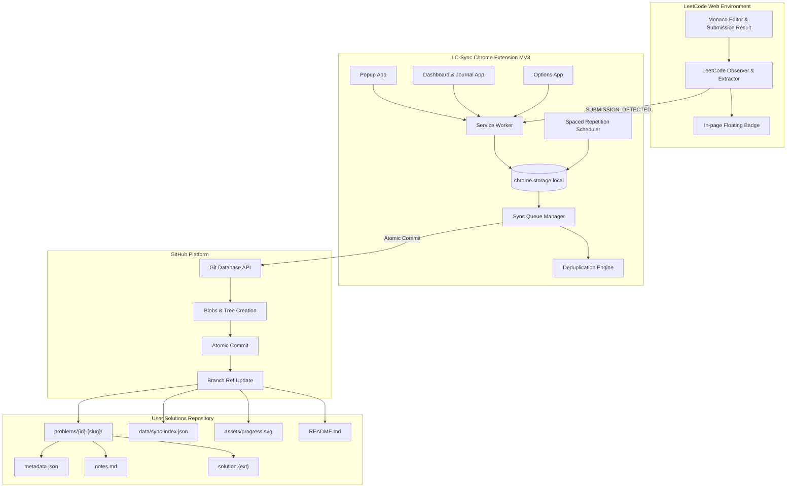

# LC-Sync Architecture & Technical Design

## 1. System Overview

LC-Sync is a local-first Chrome Extension (Manifest V3) and developer learning platform that automates the synchronization of accepted LeetCode submissions directly to a user's GitHub repository.

Unlike simple scraping tools that blindly dump source code, LC-Sync:
- Employs an isolated DOM observation pipeline to detect accepted submissions.
- Provides a mandatory manual import fallback for full resilience.
- Manages an offline-capable sync queue with bounded retries.
- Performs atomic commits via the GitHub Git Database API (`blobs` -> `trees` -> `commits` -> `refs`).
- Implements two-factor deduplication (Platform Submission ID + SHA-256 normalized content hash).
- Tracks algorithmic evolution across multiple approaches and programming languages.
- Features a built-in SuperMemo-inspired spaced repetition revision engine.
- Deterministically generates a progress SVG graphic and Markdown index while preserving manual README notes.

---

## 2. Core Subsystems

### 2.1 LeetCode Integration Adapter
- Located in `src/content/`.
- Uses a dual mechanism:
  1. Click listener on Submit buttons (`data-e2e-locator="console-submit-button"`, `data-cy="submit-code-btn"`, or text `Submit`).
  2. `MutationObserver` on `document.body` that only evaluates acceptance within a 45-second window following a user-triggered submission, preventing false-positive detections when a user merely navigates to an already solved problem.
- URL Parser (`src/core/utils/url-parser.ts`) extracts clean problem slugs, problem IDs, and submission IDs.
- Extracts code from Monaco editor DOM representations (`.monaco-editor .view-line`) or window contexts.

### 2.2 Deduplication Engine
- Located in `src/core/sync/deduplication.ts`.
- Two-level verification:
  1. **Primary**: Stable platform submission ID check against `data/sync-index.json`.
  2. **Secondary**: SHA-256 hash calculated over normalized source code (`\r\n` -> `\n`, trailing whitespace removed).
- Duplicate submissions are flagged and skipped without redundant Git commits.
- Differentiates between:
  - Exact duplicate submission.
  - New solution approach for an existing problem (e.g., brute force vs optimal hash map).
  - Code revision.
  - New problem.

### 2.3 Atomic GitHub Git Database Commits
- Located in `src/core/github/git-database.ts`.
- Avoids multiple disparate commits by issuing a single atomic commit containing all modified files:
  1. Solution file: `problems/{id}-{slug}/{lang}/{approach}.{ext}`
  2. Problem metadata: `problems/{id}-{slug}/metadata.json`
  3. Structured notes: `problems/{id}-{slug}/notes.md`
  4. Durable index: `data/sync-index.json`
  5. Deterministic progress card: `assets/progress.svg`
  6. Repository index: `README.md`
- Handles concurrent branch updates (HTTP 409 / non-fast-forward) via bounded retries and exponential backoff.

### 2.4 Smart Spaced Repetition Revision Scheduler
- Located in `src/core/revision/scheduler.ts`.
- Implements transparent, offline-capable interval scheduling:
  - Rating 1: Recall failure $\rightarrow$ interval resets to 1 day.
  - Rating 2: Needed hints $\rightarrow$ 1-2 days.
  - Rating 3: Solved with assistance $\rightarrow 1.3\times$ interval multiplier.
  - Rating 4: Solved independently $\rightarrow 2.0\times$ interval multiplier.
  - Rating 5: Mastered / reproduce confidently $\rightarrow 2.5\times$ interval multiplier.
- Sorts review queue by urgency: Overdue first, Due Today second, Upcoming third.

### 2.5 Section-Preserving Markdown Generator
- Located in `src/core/generator/readme-generator.ts`.
- Uses deterministic sentinel markers `<!-- lc-sync:start -->` and `<!-- lc-sync:end -->`.
- Preserves all manual notes, personal roadmaps, and custom sections written before or after the markers.

### 2.6 Historical Submission Import & Batch Backfill Engine
- Located in `src/core/leetcode/historical-adapter.ts` and `src/core/sync/historical-importer.ts`.
- **Authenticated Adapter**: Uses the active LeetCode browser session to query paginated submissions via GraphQL `submissionList` with fallback to REST `api/submissions/`.
- **Three Import Modes**:
  1. **Mode A (All Accepted)**: Backfills every accepted historical submission. The most recent accepted submission sits at the canonical path `problems/{id}-{slug}/{lang}/solution.{ext}`, while older accepted attempts or alternative solutions are preserved under `problems/{id}-{slug}/history/{submission-id}/solution.{ext}` with isolated metadata.
  2. **Mode B (Latest Accepted)**: Imports only the latest accepted version per problem-language combination for a compact repository.
  3. **Mode C (All Attempts)**: Optional opt-in to import unsuccessful attempts (Wrong Answer, Time Limit Exceeded, Runtime Error). Unsuccessful code is stored separately under `problems/{id}-{slug}/attempts/{submission-id}/attempt.{ext}` and never overwrites canonical solutions.
- **Bounded Batch Commits**: File updates are grouped into bounded batches (5-10 submissions) committed atomically via the GitHub Git Database API, preventing commit spam or gigantic single payloads.
- **Resumability & Checkpointing**: Persists state in `chrome.storage.local` after each batch, enabling seamless resume after browser or network interruptions.
- **Data Integrity**: Preserves original LeetCode submission timestamps in metadata, while Git commit dates honestly reflect when LC-Sync imported the files.

---

## 3. Data Storage & Schema Evolution

All local state resides in `chrome.storage.local`.

### Keys:
- `settings`: User repository, token, and preferences.
- `sync_index`: Cached copy of repository sync index.
- `sync_queue`: Queue of recent synchronizations (`Pending`, `Syncing`, `Synced`, `Failed`, `Needs Attention`).
- `active_draft`: Detected submission awaiting review.
- `problems_cache`: Metadata cache for instant offline browsing.

### Schema Versioning:
- Current schema version is `2`.
- Migrations in `src/core/storage/schema-migration.ts` automatically validate and backfill defaults for records from older versions.
