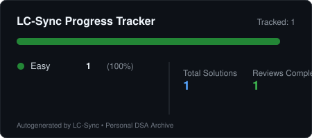

# ⚡ LeetCode Daily

> My LeetCode problem-solving journey — automatically synchronized to GitHub using LC-Sync.

<!-- lc-sync:start -->
## 📊 Progress Summary

<p align="center">
  
</p>

[](https://leetcode.com)
[](https://github.com)

- **Total Problems Tracked**: **1**
- **Distinct Problems Tracked**: **1**
- **Total Solutions & Historical Versions**: **1**
- **Profiles**: [LeetCode](https://leetcode.com)

### 🎯 Difficulty Breakdown
| Difficulty | Solved |
| :--- | :--- |
| 🟢 Easy | **1** |
| 🟡 Medium | **0** |
| 🔴 Hard | **0** |

### 💻 Language Distribution
| Language | Solved Problems |
| :--- | :--- |
| C++ | `1` |

### 🏷️ Topic Tags
`Array (1)` • `Hash Table (1)`

---

## 📚 Solution Directory

👉 **[Browse All Solutions → solutions/](./solutions/)**

### Recently Synchronized Problems

| Problem | Difficulty | Language | Solution |
| :--- | :-: | :--- | :--- |
| [0001. Two Sum](./solutions/0001-two-sum) | Easy | C++ | [hash-map-optimal.cpp](./solutions/0001-two-sum/cpp/hash-map-optimal.cpp) |

---

_Last synchronized via LC-Sync: `2026-10-24T12:00:00.000Z`_
<!-- lc-sync:end -->

### 📂 Repository Layout

```text
├── README.md                # Progress summary & solution index
├── solutions/               # All problem solutions by question number & title
│   └── 0001-two-sum/
│       ├── cpp/
│       │   └── hash-map-optimal.cpp # Source code by language
│       ├── metadata.json    # Problem metadata and revision schedule
│       └── notes.md         # Learning journal & approach notes
├── data/
│   └── sync-index.json      # Durable sync index and deduplication records
└── assets/
    └── progress.svg         # Locally generated SVG progress summary
```

_Automatically synchronized using [LC-Sync](https://github.com/prishabh3/leetcode-daily)._
